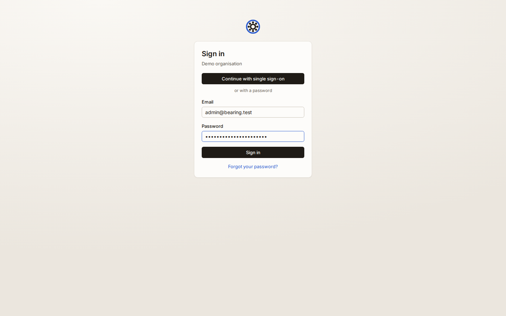
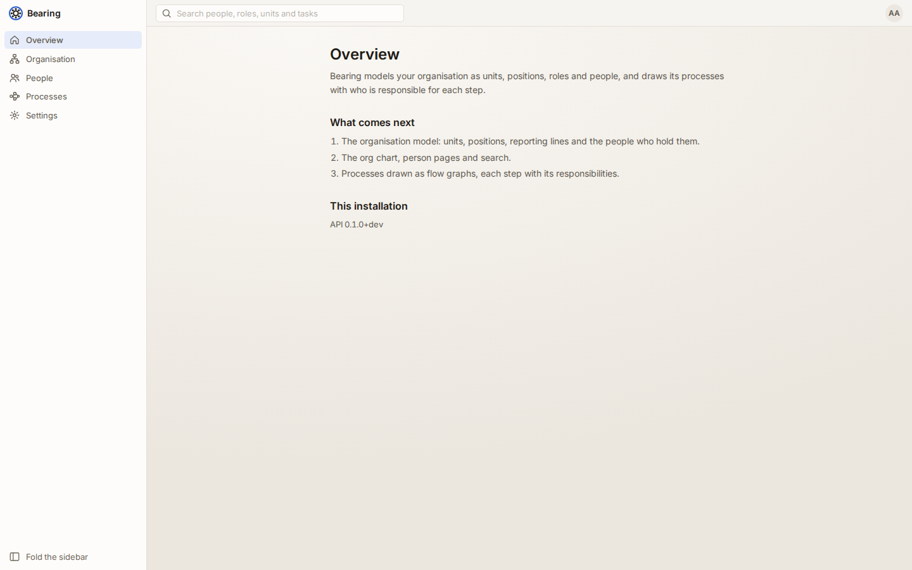
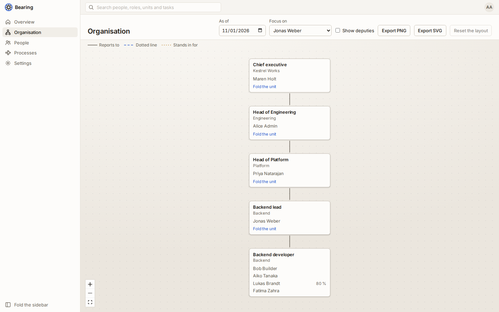
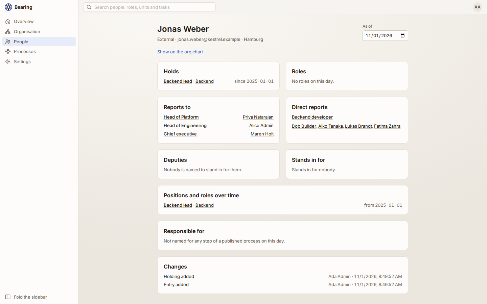
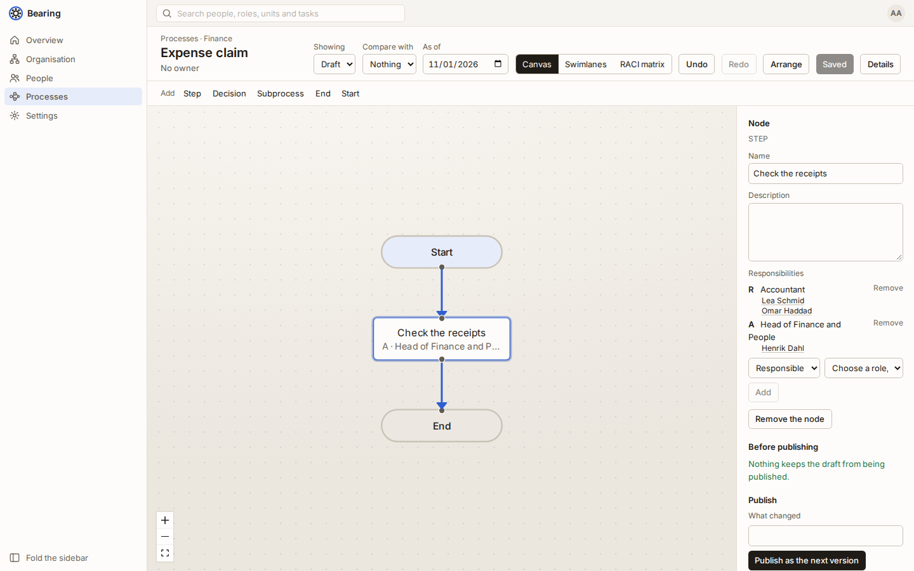
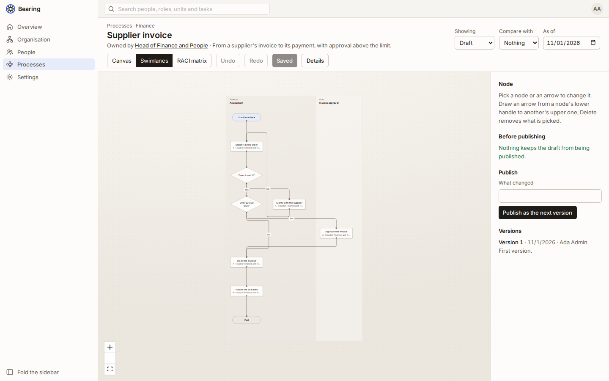
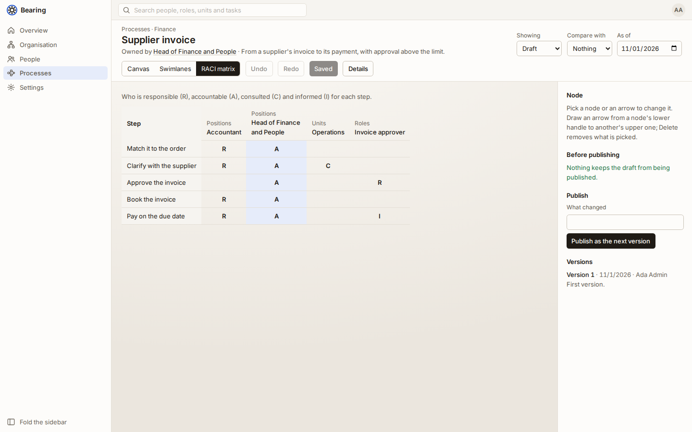
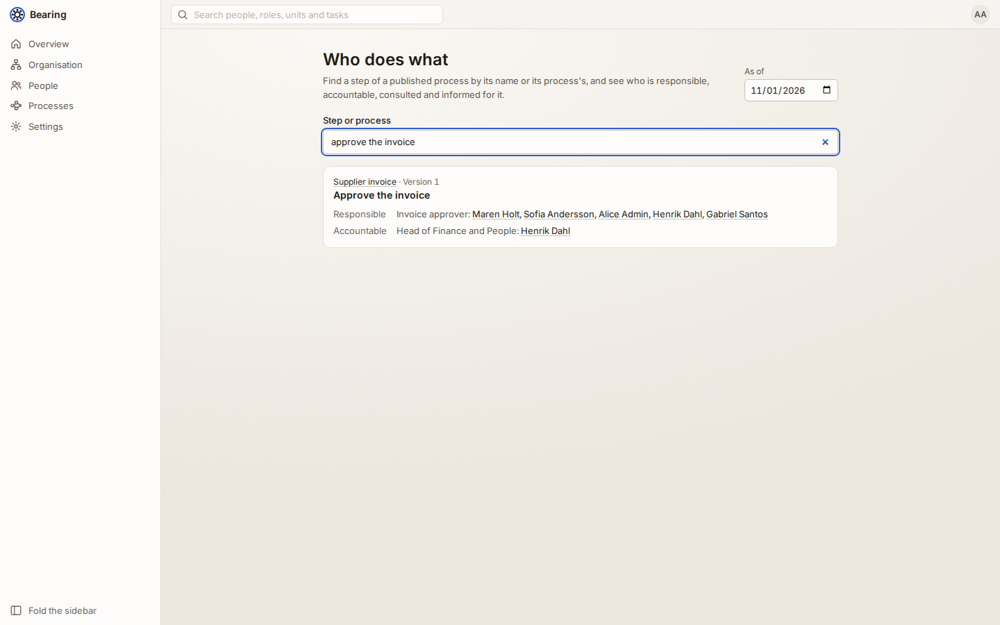
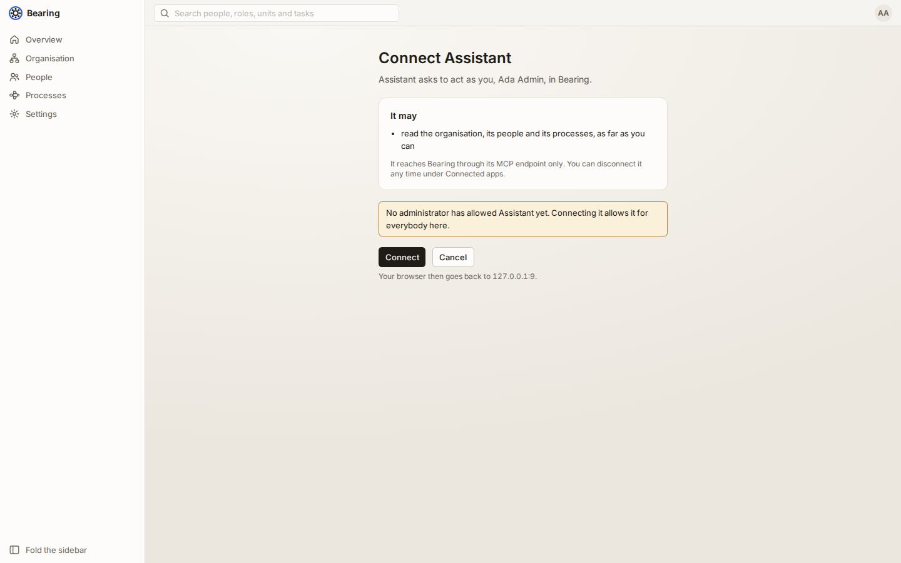
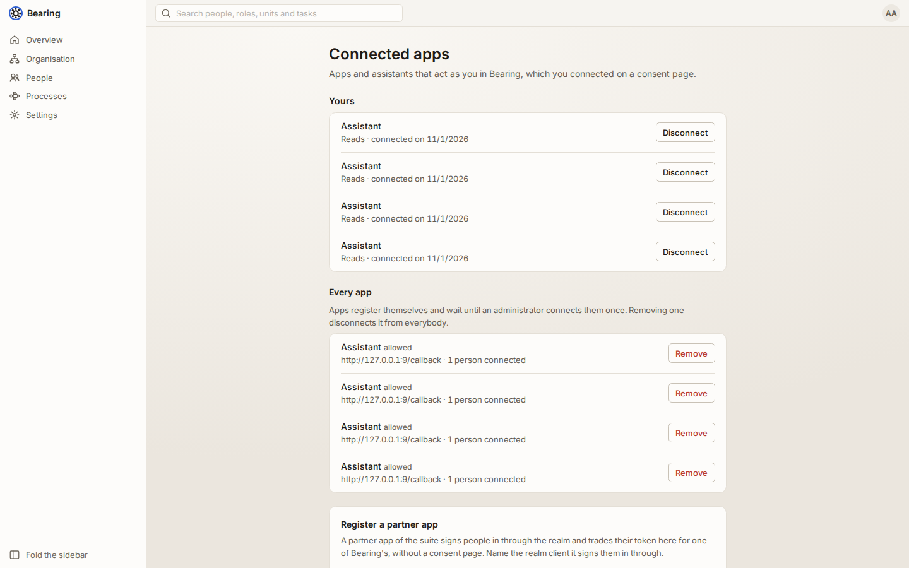

# The proof of concept

Bearing 0.1.0 shows the whole idea end to end. It models an organisation
as units, positions, people and roles with their reporting lines. It draws
the organisation's processes with who is responsible for each step. It
answers both ways: what somebody answers for, and who answers for a task.
An assistant can ask it the same over MCP, as the person it works for.

Everything below runs on one machine. The end-to-end suite walks through
the same steps (`e2e/tests/walkthrough.spec.ts`), and `make poc-screenshots`
takes the pictures here anew.

## 1. Start it

Docker, make, `jq` and `python3` are all the host needs.

```sh
make up      # Postgres with a replica, Valkey, Mailpit, Keycloak, the api, the worker and the web client
make ports   # where each of them listens; the web client is the first
```

The seed sets the installation up as "Demo organisation". It loads the
example organisation, Kestrel Works, with its processes. Open the web
client and sign in as `admin@bearing.test` with `bearing admin password`.
"Continue with single sign-on" signs in through the stack's Keycloak
instead: `alice` is an administrator, `bob` a member.





## 2. Explore the organisation

**Organisation** draws the chart. Solid lines are reporting lines, dashed
ones dotted lines, and vacant positions are marked. Pick a person under
**Focus on** to see only their chain up and the people below them. The
**As of** picker shows the organisation as it was or will be on another
day; the Head of Product changed in April 2026.



**People** lists everybody. A person's page shows the positions and roles
they hold, whom they report to, who reports to them, whom they stand in
for, and what they are responsible for in the published processes.



## 3. Draw a process

Under **Processes**, add a process and draw it. The palette adds steps,
decisions, subprocesses and ends. Draw an arrow from a node's lower handle
to another's upper one. **Arrange** lays the flow out and routes the arrows
around the nodes. Pick a step to name it and to say who is responsible (R),
accountable (A), consulted (C) and informed (I): a role, a position or a
unit. Below each one, Bearing names the people it comes down to on the day,
and a deputy stands in where a position is vacant. **Save draft** keeps the
draft. The side panel says what keeps it from being published, and
**Publish** makes it the next version, which never changes again.



The same process reads in **Swimlanes**, one lane per responsible party, and
as a **RACI matrix**. **Compare with** shows what changed between two
versions.





## 4. Ask who is responsible

**Who does what**, linked from the processes, finds the steps of the
published processes by a word. It names who is responsible, accountable,
consulted and informed for each, down to the people on the day. The other
way round, every person, position, role and unit page lists what it
answers for.



## 5. Connect an assistant over MCP

Bearing's MCP endpoint is `http://localhost:<web port>/api/v1/mcp`. An
assistant connects to it as you and reads what you may read, nothing more.
Its tools are `whoami`, `search`, `get_person`, `get_unit`, `get_position`,
`management_chain`, `reports`, `responsibilities_of`, `who_is_responsible`
and `get_process`, all reading. [`integration.md`](integration.md) says what
each answers.

With Claude Code:

```sh
claude mcp add --transport http bearing http://localhost:<web port>/api/v1/mcp
```

The first time it is used, the assistant finds Bearing's sign-in through the
endpoint's metadata, registers itself, and opens Bearing's consent page in
the browser. An administrator connects a new app once, which allows it for
everybody; after that anybody signed in connects it for themselves.



Then ask it, for example, *who approves supplier invoices above 10 000 EUR,
and who stands in while the Head of Quality's position is vacant?* It
searches, reads the supplier invoice and the people behind each step, and
answers from what Bearing holds on the day.

**Connected apps** in the account menu lists the apps you connected. Each
can be disconnected there; an administrator removes an app for everybody.



A client that cannot connect on a consent page uses a personal access
token instead. Make one under **Access tokens** in the account menu, and
send it as a header:

```sh
claude mcp add --transport http bearing http://localhost:<web port>/api/v1/mcp \
  --header "Authorization: Bearer bearing_pat_..."
```

## 6. Run it as a test

```sh
make test-e2e ONLY=walkthrough   # the walkthrough, against the running stack
make poc-screenshots             # the same, keeping the pictures in docs/poc
```
